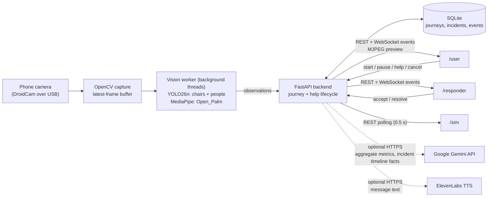

# GuideWing

**Awareness ahead. Assistance within reach.**

GuideWing explores a personal campus companion for blind, low-vision and older people who may need help getting around. This repository contains a working **web prototype**. It demonstrates the warning, help-request and human-acknowledgment workflow that a future phone app would provide. It is a hackathon prototype, not a safety or emergency product.

## 1. Overview and product vision

**The problem.** Moving across a busy campus without reliable sight means two separate worries: what is in the path ahead, and how to get a person's attention when something goes wrong. Existing tools tend to address one or the other.

**The intended experience (future product).**
- A **companion drone** gives a moving view of the path ahead.
- A **phone app** with **connected headphones** speaks short obstacle warnings, confirms help requests and announces when a responder has acknowledged.
- **Accessible Help and Cancel controls** are always available, plus optional **deliberate gestures** for hands-free requests. The sensing method for phone gestures (touch input versus camera-recognized hand poses) is **not decided yet**. These would be different mechanisms.
- A **human responder** receives each request with context (simulated location, timeline, a blurred snapshot) and acknowledges it.

**What the prototype demonstrates today.** A phone camera (via DroidCam) supplies real frames to a real detection pipeline. A FastAPI backend owns a simulated journey and the full help-request lifecycle. Web pages stand in for the future phone app (`/user`), the responder desk (`/responder`) and a 2D view of the simulated companion (`/sim`). We focus on connecting obstacle awareness, a deliberate help request and a human acknowledgment in one accessible flow. We make no claim of novelty or validated usefulness for blind users.

## 2. Implementation status

| Area | Status |
|---|---|
| Web user page, responder desk, 2D simulation, developer page | **Implemented and verified** (automated browser checks plus hands-on tests) |
| Backend journey and help lifecycle, SQLite persistence, restart recovery | **Implemented and verified** (automated tests plus real-server checks) |
| Chair warning and open-palm help request on live DroidCam frames | **Implemented and verified hands-on** under one controlled indoor setup (lit room, one participant) |
| Spoken feedback (browser speech) | **Implemented.** Speech triggering and de-duplication verified in an automated browser; audible output confirmed by the team during hands-on tests on 10 Oct |
| Responder analytics and Gemini summaries | **Implemented and verified** (metrics checked against the database; real Gemini calls succeeded) |
| Gemini response review for individual incidents | **Implemented**; live-verified by a teammate on synthetic data, not re-verified on this machine |
| ElevenLabs server voice | **Implemented, unverified.** No ElevenLabs key has been used; browser speech is the fallback |
| Screen-reader (NVDA/Narrator/TalkBack) behavior | **Unverified** |
| Native phone app, headphone audio, closed-fist or other cancel gestures | **Planned / not implemented** |
| Real drone flight, real GPS or device location | **Not implemented.** Journey and location are simulated |

## 3. Features and screens

All pages are served by the backend on one port (default `http://127.0.0.1:8000`).

**`/user`: companion (stands in for the future phone app)**
- **Journey:** Start journey, Pause/Resume, and Start a new journey when one ends; progress shown as a percentage, with the **simulated** location and landmark.
- **Always-present controls:** **Help**, **Cancel** and **Repeat last message**. Unavailable controls stay focusable and explain why (for example "A help request is already active").
- **Countdown:** a 10-second cancellation countdown that follows the server's deadline.
- **Speech:** messages are spoken once per event and never replayed automatically after a refresh. **Repeat** replays the last message on demand.
- **Settings:** choose spoken feedback, screen-reader announcements or text only; toggle single-key shortcuts (**H** Help, **C**/**Esc** Cancel, **R** Repeat, **P** Pause/Resume); end the journey.
- **Camera panel:** input mode (LIVE / REPLAY / TEST / unavailable), recognition status, and an annotated live preview showing the monitored region, detected chairs, people and hand landmarks.
- **Connection:** a status badge with a retry option if the server becomes unreachable.

**`/responder`: responder desk**
- **Active queue:** pending requests are visible but cannot be accepted until dispatched. Dispatched requests can be **accepted**, then **marked resolved**.
- **Request detail:** input method, location source (labeled simulated), recorded timeline, a deterministic briefing, an optional Gemini response review, and the **blurred snapshot** when one was captured.
- **History:** cancelled and resolved requests.
- **Analytics:** totals, current-status counts and average dispatch-to-acceptance and acceptance-to-resolution times for a chosen period, plus an optional Gemini **Summary**.
- If two responders accept the same request, one sees "Server confirmed" and the other "Already handled".

**`/sim`: 2D simulation.** A backend-connected 2D route with the participant and companion. It polls the same state the backend owns and never moves the route itself. It shows a disconnection warning when the backend stops responding.

**`/dev`: developer controls.** Reset the demo journey, inject **TEST** obstruction or palm observations, open **MOCK** state fixtures, view vision status and copy the current journey ID. TEST, MOCK and REPLAY inputs are labeled on every page and are never presented as live detection.

## 4. Architecture



- **The backend is authoritative.** It owns route progress, the simulated location, deadlines and every status change. Pages only display server state; their countdowns never dispatch anything.
- **Communication:** the pages use REST for actions and state. `/user` and `/responder` also listen on a WebSocket (`/ws/events`) for immediate updates and re-read REST state after a reconnect. `/sim` polls the state snapshot every 0.5 s. The camera preview is an MJPEG stream.
- **Vision runs off the request path:** capture and inference run in background threads; stale frames are dropped rather than queued.
- **Speech has one owner:** speech is produced only by the `/user` page.

**Planned architecture (not built):** drone camera → native phone app → headphone audio, with the same backend lifecycle and responder desk.

## 5. End-to-end workflow

1. **Start** a simulated journey (`idle` → `active`). The backend advances progress along a configured 180-second route of illustrative waypoints.
2. **Chair detected:** when a chair (confidence ≥ 0.45) overlaps the configured image region for about **1 second**, the backend publishes an obstruction.
   - Once the journey has started, the user hears **one** spoken warning and an active journey pauses (`paused`, reason `obstruction`).
   - A chair seen before Start is shown as status only, with no speech.
   - Further warnings are limited by a 10-second cooldown.
3. **Clear and resume:** the obstruction clears after about 1.5 s without a detection. The journey **does not resume on its own**; the user presses Resume (or **P**).
4. **Request help:** the **Help button** and an **open palm held for 2 seconds** create the same request. The palm only counts while the journey is active or paused.
   - One sustained hold creates exactly one request.
   - Brief or interrupted palms do not count.
   - The gesture re-arms only after the hand has been lowered for 1 s **and** the previous request has ended.
5. **Lifecycle:**
   - A request starts as `pending` with a **10-second cancellation window** owned by the server, then becomes `dispatched`.
   - A responder accepts it (`acknowledged`) and later marks it `resolved`.
   - The user can cancel while `pending` or `dispatched` (`cancelled`); a cancelled request is never dispatched later.
   - Repeated submissions return the same request, and each journey has at most one open request.
6. **Feedback:** the user hears each change once: request started, sent, accepted, cancelled. The responder sees the context and the recorded timeline.
7. **History:** `cancelled` and `resolved` requests move to responder History and remain in the database.

Exact field names, statuses and endpoints are in [docs/CONTRACT.md](docs/CONTRACT.md).

## 6. Technology stack

| Layer | Technology (version from the manifests) |
|---|---|
| Backend | Python 3.14, FastAPI 0.143, Uvicorn 0.54, Pydantic 2.14, `websockets` 17.2 |
| Database | SQLite (Python standard library), WAL mode |
| Camera and images | **OpenCV** (`opencv-contrib-python` 5.0) for capture (Media Foundation, with DirectShow fallback), drawing the preview overlay, JPEG encoding and the snapshot blur |
| Object detection | **Ultralytics YOLO26n** (8.4.175, pretrained COCO weights) on PyTorch 2.14 CPU: chairs as obstructions, people as overlays only |
| Hand gesture | **MediaPipe Tasks Gesture Recognizer** (1.1.0, `gesture_recognizer.task`): the `Open_Palm` category |
| Frontend | React 19.3, TypeScript 6.0, Vite 8.3 (portable Node 24 inside `tools/`) |
| Optional services | Google **Gemini** Developer API (`gemini-3.8-flash` default); **ElevenLabs** text-to-speech (implemented, unverified) |
| Camera bridge | DroidCam (phone app plus Windows client, USB) |

## 7. Setup and run (Windows, PowerShell)

**Prerequisites:** Windows 10/11 with the `py` launcher and Python 3.14. Everything else installs **inside this folder**: `.venv`, portable Node in `tools\node`, and models in `models\`.

```powershell
cd "C:\guide_wing\Guide_wing"
powershell -ExecutionPolicy Bypass -File scripts\setup.ps1      # once: venv, packages, Node, frontend build, models, checks
```

**Optional configuration:** copy `.env.example` to `.env` (git-ignored; the launcher loads it and prints variable names only). Never commit real keys.

```dotenv
GEMINI_API_KEY=<your-key>              # optional: Gemini summaries and incident reviews
GEMINI_MODEL=gemini-3.8-flash          # optional override (incident review)
GEMINI_ANALYTICS_MODEL=gemini-3.8-flash
ELEVENLABS_API_KEY=<your-key>          # optional: server voice; browser speech otherwise
```

Detection settings use `GUIDEWING_*` names: `GUIDEWING_PATH_REGION`, `GUIDEWING_CHAIR_CONFIDENCE`, `GUIDEWING_PALM_SCORE` and others. See [.env.example](.env.example).

**Start and stop**

```powershell
powershell -ExecutionPolicy Bypass -File scripts\start.ps1 -Camera 0     # live camera at index 0
powershell -ExecutionPolicy Bypass -File scripts\start.ps1 -NoVision     # button-only, no camera
powershell -ExecutionPolicy Bypass -File scripts\start.ps1 -Video clip.mp4   # labeled REPLAY input
powershell -ExecutionPolicy Bypass -File scripts\start.ps1 -Rebuild      # rebuild the web pages first
powershell -ExecutionPolicy Bypass -File scripts\stop.ps1                # stops only the server start.ps1 launched
```

Open **http://127.0.0.1:8000/user**, **/responder**, **/sim** (and **/dev** for TEST controls). The server binds to `127.0.0.1` by default; `-Lan` opts into LAN access for a trusted network only.

**DroidCam over USB**
1. Install DroidCam on the phone and the DroidCam Windows client. Enable USB debugging on the phone and connect with a data cable.
2. Open the phone app, then in the client choose **USB → Start**. Wait until the client shows video.
3. **Start the backend after DroidCam is streaming.** If the backend opens the camera first, it can keep receiving black frames; restart the backend to fix that.
4. **Camera numbers can change between runs.** DroidCam is the 640×480 device; a Windows "connected camera" placeholder may appear as another index. With the backend stopped, run `.\.venv\Scripts\python.exe scripts\test_camera.py --list`, then start with the matching `-Camera <index>`.
5. Use a lit room. Aim the phone so the yellow **monitored path region** on the preview covers the floor where a chair would be.

**Troubleshooting**
- **Port in use:** `start.ps1` refuses to start and names the process holding the port. Check what it is before stopping anything, or use `-Port 8001`. `stop.ps1` only ends the process tree it started.
- **Camera busy:** only one program can own the camera. Close other camera apps; stop the backend before running `test_camera.py`.
- **Optional services:** without keys, the app runs fully. Gemini buttons explain the missing setup, and speech uses the browser.

## 8. Demonstration and verification

**Live demo (about 2 minutes):**
1. Start journey on `/user`. `/sim` moves.
2. Place the chair in the region: you hear the spoken warning and the journey pauses.
3. Remove the chair and press **P** to resume.
4. Hold an open palm for 2 s: a request starts and is sent after 10 s.
5. Accept on `/responder`: you hear the spoken confirmation.
6. Mark resolved, then open Analytics → **Generate summary**.

**Fallbacks:** button-only (`-NoVision`, press **H**) and a labeled REPLAY clip (`-Video`). Runbooks: [docs/DEMO_SCRIPT.md](docs/DEMO_SCRIPT.md), [docs/BACKUP_VIDEO_SCRIPT.md](docs/BACKUP_VIDEO_SCRIPT.md), [docs/BACKUP_PLAN.md](docs/BACKUP_PLAN.md).

**Automated checks**

```powershell
.\.venv\Scripts\python.exe -m pytest                                   # backend: 89 tests
powershell -ExecutionPolicy Bypass -File scripts\build_frontend.ps1    # strict TypeScript + production build
$env:PATH = "$PWD\tools\node;$env:PATH"; tools\node\npm.cmd --prefix frontend test   # 5 Node tests
.\.venv\Scripts\python.exe scripts\check_environment.py                # imports and real model inference
```

The end-to-end scripts **change data**, so run them against a separate test server with its own database:

```powershell
$env:GUIDEWING_DB_PATH = "$env:TEMP\guidewing-test.sqlite3"; $env:GUIDEWING_VISION_SOURCE = ""
.\.venv\Scripts\python.exe -m uvicorn backend.app.main:create_default_app --factory --port 8010
# in a second terminal:
.\.venv\Scripts\python.exe scripts\e2e_check.py --base http://127.0.0.1:8010        # 16 API checks, real 10 s clock
tools\node\node.exe scripts\web_browser_check.cjs http://127.0.0.1:8010             # 45 checks in headless Edge
```

`web_browser_check.cjs` needs `playwright-core` once: `$env:PLAYWRIGHT_SKIP_BROWSER_DOWNLOAD=1; tools\node\npm.cmd --prefix tools\browsertest install playwright-core`. It uses the installed Microsoft Edge.

**Recorded results (11 Oct 2026, this laptop):**

| Check | Result |
|---|---|
| Backend tests, Node tests, frontend type/build | 89/89, 5/5, pass |
| API end-to-end on the real clock | 16/16 |
| Browser workflow in headless Edge: journey, pause/resume, 10 s deadline, cancel, two responders, refresh without replay, connection loss, labels | 45/45 |
| Live DroidCam, hands-on with a server-side event log: chair warning and pause, one request per 2 s palm hold, no retrigger while still holding after cancel, interrupted holds ignored, blurred snapshot attached, button Help | Pass |
| Live processing rate | About 19–20 fps, 48–57 ms per frame on CPU (Ryzen 9 5900HS). This is processing speed, **not** detection accuracy or end-to-end latency |
| Real Gemini summary | Succeeded (about 16 s); every number matched the database |

**Outstanding:**
- a screen-reader pass
- a live gesture request taken all the way to acknowledgment in the same recorded session (done in hands-on tests on 10 Oct, not re-recorded on 11 Oct)
- ElevenLabs with a real key

Detailed history: [docs/PROGRESS.md](docs/PROGRESS.md) and [docs/HANDS_ON_TEST_CHECKLIST.md](docs/HANDS_ON_TEST_CHECKLIST.md).

## 9. Analytics and AI services

- **Counts, rates and durations are computed by application code** from stored records (the latest 500 requests): totals, status counts, and average dispatch-to-acceptance and acceptance-to-resolution times. Cancelled requests are never counted as resolved, and missing timings show as "No qualifying records", not zero.
- **Gemini summarizes metrics it is given; it does not produce them.** The Summary receives aggregate counts and timings only: no incident IDs, names, locations, timelines, images or raw records. It does not decide urgency, dispatch or anything about crime. The backend rejects output with numbers that don't appear in the supplied facts, which reduces fabrication but doesn't prove accuracy.
- **Incident response review (optional):** Gemini receives the input method, status, location source, timeline event types and times, and computed elapsed seconds for one request. Coordinates, landmarks, responder identity, IDs and image content are excluded.
- **ElevenLabs (optional, unverified):** if configured, the text of a `/user` message is sent to ElevenLabs and the audio cached locally. Any failure falls back to browser speech.
- **Keys stay on the server** (in `.env`). They never appear in the web bundle or API responses.
- **Failures don't block help:** timeouts, quota errors and temporary HTTP 503 responses appear as messages with a retry. Metrics, Help, Cancel and responder actions keep working. AI results are kept in memory only.

Details: [docs/GEMINI_ANALYTICS.md](docs/GEMINI_ANALYTICS.md).

## 10. Limitations and privacy

- **This is a prototype.** It is not validated safe navigation and not emergency infrastructure. **No real emergency service is ever contacted.**
- **Detection is narrow:** one obstacle class (chairs) in one configured image region, and one deliberate gesture (open palm), tuned for one participant in a lit, controlled setup. It doesn't measure distance or decide whether a path is safe. People are drawn as overlays and never treated as obstacles.
- **No crime or threat detection.** A staged scenario may motivate a request, but the system only recognizes the user's deliberate request.
- **Simulation:** the companion's movement, the journey and the location are simulated. Route coordinates are illustrative, not surveyed.
- **Future experience:** the phone app and headphone experience are the intended future product; the website stands in for them today.
- **The responder is a demo role.** It is not connected to Georgia State University Police or any campus service, and the project claims no GSU endorsement or partnership.
- **No user research** with blind, low-vision or older participants has been done yet.

**Data handling:**
- SQLite stores journeys, requests and their timelines (`backend/data/`).
- Snapshots are the **whole frame pixelated and blurred in memory before the only write**. They are blurred, **not guaranteed anonymous**, and omitted if no fresh frame exists.
- Raw camera frames stay in memory. The **live preview stream is not blurred**.
- Optional speech audio is cached in `backend/data/tts_cache/`.
- There is no automatic retention limit or deletion yet, and no authentication. Keep the default local-only binding outside a trusted network.

More: [docs/LIMITATIONS.md](docs/LIMITATIONS.md).

## 11. Future extensions (planned, not implemented)

- An accessible native phone app with headphone audio.
- Optional phone gesture controls, with the sensing method still to be chosen and validated.
- Validated real location with the user's consent.
- Controlled drone hardware trials and broader obstacle detection.
- Studies with blind, low-vision and older users.
- Authorized partnerships with campus assistance and safety services.
- Research into recognizing possible distress cues, always with user confirmation. This is a research direction, not a capability today.

## 12. Repository guide, credits and license

```
backend/app/         FastAPI app, lifecycle services, SQLite, schemas, analytics, optional providers
backend/app/vision/  camera opening, capture/inference worker, gesture and obstruction timing rules
backend/tests/       pytest suites (controlled clock)
frontend/src/        React pages: user, responder (with analytics), sim, dev
scripts/             setup, start/stop, environment and camera checks, end-to-end and browser checks
docs/                contract, architecture, frontend, Gemini analytics, demo runbooks, limitations, progress
models/              downloaded model files (git-ignored)
```

Useful docs: [CONTRACT](docs/CONTRACT.md) · [ARCHITECTURE](docs/ARCHITECTURE.md) · [FRONTEND](docs/FRONTEND.md) · [GEMINI_ANALYTICS](docs/GEMINI_ANALYTICS.md) · [LIMITATIONS](docs/LIMITATIONS.md) · [SUBMISSION_CHECKLIST](docs/SUBMISSION_CHECKLIST.md). Agent orientation: [AGENTS.md](AGENTS.md).

**Third-party components**

| Component | Use | License |
|---|---|---|
| Ultralytics and YOLO26n weights | Chair and person detection | AGPL-3.0 |
| MediaPipe and `gesture_recognizer.task` | Open-palm recognition | Apache-2.0 |
| OpenCV | Capture, drawing, encoding, blur | Apache-2.0 |
| PyTorch | Detector runtime | BSD-3-Clause |
| FastAPI, Starlette, Pydantic, Uvicorn | Backend | MIT / BSD |
| React, Vite, TypeScript | Frontend | MIT / Apache-2.0 |
| Google Gemini API, ElevenLabs API (optional) | Summaries, speech | Provider terms of service |

Prior work: Tan et al., *Flying Guide Dog* (2021), https://arxiv.org/abs/2108.07007.

**License:** GNU Affero General Public License v3.0. See [LICENSE](LICENSE). AGPL-3.0 was chosen because the project depends on AGPL-licensed Ultralytics YOLO components.
