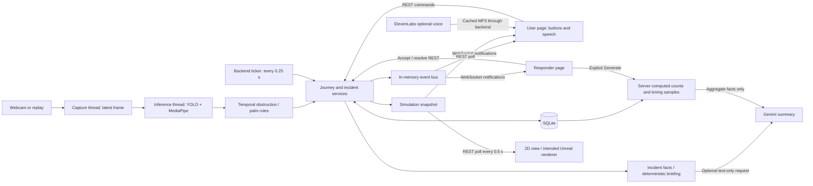

# GuideWing implementation reference

Reviewed 2026-10-10 from source, configuration, scripts, tests, and status documents. This describes the current `Guide_wing` repository, separate from sibling Unreal project `GuideWingSim`. No camera or sponsor service was activated for this review. SQLite was opened read-only to confirm its table layout; no personal incident content was copied here. Dependency trees, weights, generated bundles, secrets, and runtime media are not architecture source.

This is a cached map of the code. Use [../AGENTS.md](../AGENTS.md) for quick orientation and [ARCHITECTURE_INDEX.json](ARCHITECTURE_INDEX.json) with [the read-only freshness checker](../scripts/check_architecture_index.py) to identify source changes before relying on cached details.

## 1. Runtime and ownership



One Uvicorn process hosts FastAPI and serves the Vite build. The vision worker is two threads inside that process, not a separate network service. SQLite and the event bus are local to that process. The architecture is designed for a local hackathon demo, not multiple Uvicorn workers coordinating through a shared event system.

Startup: `main.create_default_app()` -> `create_app()` -> `Services`. Services open the database, load route JSON, wire journey/incident/vision callbacks, configure optional providers, process overdue incidents, and ensure a current journey exists. FastAPI lifespan starts the ticker and vision threads; shutdown stops them and closes SQLite. Snapshot attachment and Gemini generation use additional daemon threads when requested.

Backend owns decisions. Frontend countdowns and rendering are presentation. `/user` is the speech owner; responder and 2D views do not speak. Intended Unreal behavior is polling and rendering the same snapshot; a documented contract is not evidence that the current Unreal build is connected.

## 2. Models and recognition

| Component | Model/configuration | Role and source |
|---|---|---|
| Object detection | `models/yolo26n.pt`; Ultralytics YOLO26n, CPU, inference size 640 | `vision/service.py`: filters classes by model names chair/person |
| Hand gesture | `models/gesture_recognizer.task`; pretrained MediaPipe Tasks Gesture Recognizer | VIDEO mode, one hand; top gesture must be `Open_Palm` |
| Optional briefing | Configurable `gemini-2.5-flash` default | `sponsors.py`: Gemini `generateContent`, JSON summary of textual incident facts |
| Optional aggregate analytics | Configurable `gemini-3.8-flash` default via `GEMINI_ANALYTICS_MODEL` | `analytics.py`: qualitative Gemini commentary on server-computed counts and timing samples; same server API key |
| Optional speech | Configurable `eleven_flash_v2_5`; voice `JBFqnCBsd6RMkjVDRZzb` | `sponsors.py`: ElevenLabs text-to-speech, MP3 44.1 kHz / 128 kbps |
| Default speech | Browser `SpeechSynthesis` | `frontend/src/speech.ts`; OS/browser voice, no local custom voice model |

There is no custom training, speech recognition, navigation model, crime classifier, or Unreal-image inference. The downloader retrieves MediaPipe's float16 latest model asset and uses Ultralytics' asset downloader for YOLO weights. See [download_models.py](../scripts/download_models.py) and [requirements.txt](../requirements.txt); do not assume future downloads of a latest asset are byte-identical.

Capture owns the camera and overwrites a single newest-frame slot. Inference consumes the latest frame rather than accumulating a video backlog. Replay loops and is paced using the clip FPS. Windows camera opening tries MSMF, then DirectShow, and requires an actual readable frame. Camera errors trigger reopening attempts. Status becomes not-ready when inference output is stale (two-second freshness threshold).

Default chair rules: confidence >= 0.45; region `(0.25, 0.45, 0.75, 1.0)` in normalized image coordinates; at least 25% of the chair box area inside that region; approximately one second of persistence. It clears after 1.5 seconds without a qualifying chair, and spoken warnings have a ten-second cooldown. People use confidence >= 0.5 and are drawn as overlays only. This is box/region overlap, not distance measurement or safe-path discovery.

Default palm rules: `Open_Palm` score >= 0.6, hold two seconds, tolerate short gaps up to 0.35 seconds, and release for one second to rearm after a consumed hold with no open incident. Idle/ended journeys cannot request help. Latching prevents a held palm from repeatedly creating incidents. Gesture and button requests share the same incident service. Developer injections are labeled TEST; a replay gesture still has request source `gesture`, while the vision input label identifies replay.

## 3. Journey, incident, and timing

Journey: `idle -> active <-> paused -> ended`. Active/paused are armed. Pause reasons: `user`, `obstruction`, `help_request`. Creating a new journey closes open incidents on the previous current journey and ends it; reset does not erase existing closed history. Resume is explicit, including after cancellation/acceptance/resolution. Current `resume()` validates journey state but does not independently require the incident to be resolved or declare the path safe.

Incident:

```text
pending -- backend deadline --> dispatched -- accept --> acknowledged -- resolve --> resolved
   |                               |
   +---- cancel --> cancelled <-----+
```

`acknowledged` remains open and blocks another request until resolved. Cancel is permitted from pending/dispatched, not acknowledged. A repeated transition to the existing target returns unchanged rather than duplicating it. Invalid transitions return 409.

Each request has a unique `request_key`. Retrying that key returns the same incident, including after cancellation; a new episode needs a new key. A partial unique SQLite index also enforces one open incident per journey. Button retry keys are held in page memory, not persisted across a reload.

Deadline uses UTC `dispatch_at`, default created time + ten seconds. The ticker processes deadlines every 0.25 seconds. Incident reads and commands also process overdue deadlines; a GET can therefore settle an expired pending request, though snapshot reads never advance the route. At the deadline boundary (`now >= dispatch_at`), cancellation is recorded after dispatch. Startup applies overdue deadlines from persisted data.

SQLite uses one connection, a reentrant lock, WAL journal mode, foreign keys, and `BEGIN IMMEDIATE` transactions. Incident updates use expected-status guards. Incident row mutation and its timeline event are committed together. Creating an incident, pausing its journey, and publishing notifications are separate operations; do not describe the whole cross-component workflow as one atomic transaction or a durable message queue.

Route progression is `dt / route_duration_s` only for active journeys. Default duration is 180 seconds of walking; each ticker step is capped at one second, preventing a large jump after a stall. Progress is persisted each tick; arrival ends the journey. `route.py` derives interpolated simulated coordinates and waypoint labels from [route_campus_demo_v1.json](../backend/app/route_campus_demo_v1.json). Device-location override is supported by API, but no browser geolocation acquisition is wired in. Incident location is captured at request creation and remains fixed as the journey moves.

## 4. Exactly what is stored where

All paths below are relative to the repository. `GUIDEWING_DB_PATH` can override the database path.

| Data | Location | Persistence / behavior |
|---|---|---|
| Current journey pointer | SQLite `meta.current_journey_id` | Survives restart; points to a journey UUID |
| Journey state | SQLite `journeys` | ID, created/status/armed/pause reason, route/progress, progress timestamp, optional device-location JSON, version |
| Help-request state | SQLite `incidents` | Journey FK, unique request key, source/status, scheduled and actual event times, frozen location JSON, snapshot path, responder, version |
| Incident history | SQLite `incident_events` | Ordered seq, incident FK, event type, UTC timestamp, detail; exposed as detail endpoint timeline |
| Database files | `backend/data/guidewing.sqlite3` plus `-wal` / `-shm` during WAL operation | Local SQLite; runtime folder is git-ignored |
| Snapshot image | `backend/data/snapshots/<incident UUID>.jpg` | Whole frame pixelated/blurred in RAM before JPEG write; database stores path, not image bytes |
| Raw frame / detections / annotated preview | Vision thread memory | Newest-frame buffers; annotated MJPEG preview is **not blurred**; raw frames are not written by this code |
| ElevenLabs phrase audio | `backend/data/tts_cache/<hash>.mp3` | SHA-256 of `voice_id|model_id|trimmed_text`, truncated to 32 hex characters; reusable across restart |
| Gemini summary / pending/error status | `GeminiBriefing._results` in process RAM | Keyed by incident ID; lost on restart; no report/analytics table or durable AI-output store |
| Aggregate Gemini jobs / summary text | `AnalyticsSummaries._jobs` in process RAM | SHA-256 of model/prompt version/selection/figures; 15-minute ready reuse, 30-second failure cooldown, maximum 64 jobs/two pending; lost on restart |
| WebSocket event delivery | EventBus subscriptions in RAM | Boot ID, sequence, revision; per-subscriber queue limit 200; no replay log |
| Last spoken text / dedupe keys | Browser localStorage | `guidewing.lastMessage`, `guidewing.spokenKeys` (last 200 keys); separate per browser origin/profile |
| UI state and active retry key | React state/refs | Memory only; audio enablement needs a gesture after page load |
| Model weights | `models/` | Downloaded local assets; ignored by git |
| Route configuration | `backend/app/route_campus_demo_v1.json` | Versioned illustrative waypoints, not GPS observations |
| Snapshot examples | `docs/fixtures/*.json` | Versioned mock fixtures and historical live API captures; not a runtime database |
| Built frontend | `frontend/dist/` | Generated by Vite and served by FastAPI; ignored by git |
| Backend logs / launcher PID | `logs/backend.out.log`, `logs/backend.err.log`; `run/backend.pid` | Launcher-managed local artifacts; ignored by git |
| Optional API keys | Environment, optionally local `.env` read by launcher | Server-side; `.env` ignored; never store in notes or hash manifest |

Snapshot capture runs asynchronously only for newly created non-TEST requests with snapshots enabled and a fresh camera frame. Failure omits the image without blocking help. The preview is live annotated video, distinct from the blurred persisted snapshot. No automatic retention/cleanup or database migration system is implemented; initialization creates tables/indexes if absent.

## 5. Endpoints and their consumers

Routes are registered in [main.py](../backend/app/main.py); lifecycle/snapshot Pydantic shapes are in [schemas.py](../backend/app/schemas.py), and analytics shapes in [analytics.py](../backend/app/analytics.py). JSON uses snake_case, UTC ISO timestamps with `Z`, and explicit nulls. Missing resources return 404; conflicts 409; validation errors generally 422. FastAPI also exposes `/docs`, `/redoc`, `/openapi.json` with its default configuration.

| Method and path | Purpose |
|---|---|
| GET `/api/health` | Boot/schema/version, current journey ID, DB/vision/provider configuration; provider name does not prove real-call success |
| POST `/api/journeys` | Create idle journey, make current, end/close previous journey workflow |
| GET `/api/journeys/{id}` | Journey; `current` alias follows current UUID |
| POST `/api/journeys/{id}/{start,pause,resume,end}` | Backend journey commands |
| POST `/api/journeys/{id}/location` | Validated device/unavailable location override; no location capture UI |
| POST `/api/incidents` | `{journey_id, request_key, request_source}`; 201 new, 200 duplicate |
| GET `/api/incidents` | Newest-first list; optional journey/status filters, default limit 100 and maximum 500; responder UI requests 50 |
| GET `/api/incidents/{id}` | Full incident and persisted event timeline |
| POST `/api/incidents/{id}/{cancel,accept,resolve}` | Lifecycle commands; optional `{responder}` on acceptance |
| GET `/api/incidents/{id}/snapshot` | Persisted blurred JPEG, or 404; no-store header |
| GET `/api/incidents/{id}/briefing` | Deterministic briefing plus optional Gemini summary/status; triggers async generation when eligible |
| GET `/api/analytics/config` | Safe configuration/model metadata, no external generation or key exposure |
| POST `/api/analytics/summary` | `{range: day\|week\|loaded, include_tests: boolean}`; server filters latest 500 incidents and explicitly starts/joins cached aggregate summary |
| GET `/api/analytics/summary/{job_id}` | Read cached job/snapshot only; 404 after restart/eviction; never regenerates |
| GET `/api/speech?text=...` | Cached/generated ElevenLabs MP3 for text up to 300 chars; 404 unconfigured, 502 provider failure |
| GET `/api/simulation/state?journey_id=...` | Combined journey/open/latest incident/vision snapshot for browser and intended Unreal; current alias or mock scenario |
| GET `/api/simulation/route` | Route ID/duration, waypoints and normalized progress marks for renderer |
| GET `/api/vision/status` | Input/readiness/error, frame age, FPS/inference time, obstruction, gesture hold/rearm |
| GET `/api/vision/stream` | Annotated JPEG multipart stream, not a recording; 503 without live/replay mode |
| WS `/ws/events` | Hello, notifications, 15-second idle ping; browser refreshes REST state on reconnect or event gap |
| POST `/api/dev/reset` | New current idle journey; closes previous open incidents |
| POST `/api/dev/vision/{obstruction,clear,palm}` | TEST observations through normal hooks |
| GET `/api/dev/mock-scenarios` | Available mock snapshot names |
| GET `/`, `/user`, `/responder`, `/sim`, `/dev` | Same Vite HTML entry, page selected by pathname |
| GET `/assets/...` | Built frontend assets |

Developer API routes are conditional on `GUIDEWING_DEV_CONTROLS` (default true). The HTML `/dev` route can still be served when developer APIs are disabled. Web pages/assets are mounted only if the frontend build exists. The application has no authentication, SMS/calling integration, or real emergency dispatch.

## 6. Frontend updates, speech, and Unreal boundary

`frontend/src/api.ts` wraps fetch with an eight-second timeout and mirrors backend types. React pages use local state/hooks, not a separate global store or client database. `main.tsx` selects pages by pathname; both `/` and `/user` open the companion. Home/Settings use hash navigation while retaining the mounted controls; starting a new journey waits for any current help request to close; no router package is installed. The charcoal/mint theme, original SVG drone entrance, static reduced-motion loading, and persistent assistance bar are in `ui.tsx`, `styles.css`, and `UserPage.tsx`. Read [FRONTEND.md](FRONTEND.md) for setup, implementation boundaries, and fresh validation evidence.

`events.ts` reconnects WebSockets with increasing delay up to 2.5 seconds. Reconnect/new boot/sequence gaps request REST state again; missed events are not replayed from disk. One REST poll per hook may be in flight. Current page polling: user snapshot every 1 second plus vision every 2 seconds; responder latest-500 list every 2 seconds with event-triggered refresh and selected incident detail every 3 seconds; 2D snapshot every 0.5 seconds; dev vision every 1 second and journey every 2 seconds. A pending incident AI briefing is rechecked up to 15 times at two-second intervals after the user chooses View incident briefing. Analytics displays deterministic client aggregates; explicit Generate asks the backend to recompute a server-clock snapshot. Its pending job is read once a second for up to 45 seconds, with explicit status recovery after transport failure. Filters/navigation/refresh never trigger aggregate Gemini generation.

The snapshot supplies schema version, data source, boot ID, revision, server sample time, journey, active incident, last incident, and vision. Boot/revision are process-local; reset revision tracking on a new boot. Cancelled/resolved incidents move out of `active_incident` and remain in `last_incident`. Mock snapshots have fixed scenarios and labels, not an advancing live journey.

`SimPage` projects route waypoints into SVG and adds at most half a second of visual extrapolation while active. It never writes progress. Reduced motion removes extrapolation; it displays errors/staleness. Intended Unreal polls every 0.5 seconds and follows a local spline, freezes on disconnection, and applies boot/revision rules. See [UNREAL_INTEGRATION.md](UNREAL_INTEGRATION.md): older starter `JourneyId=demo` gets 404; `current` returns a real UUID and fails the starter's strict identity check without the documented fix. Do not assume that starter is installed in the scene.

`speech.ts` deduplicates incident status and obstruction announcements; first-load current state is seeded to avoid replaying an old acceptance. Repeat deliberately reuses the latest visible message. Settings offers app voice, screen-reader live announcements, or text only; app voice and the live region are not active together. Single-key shortcuts can be disabled. Speech needs a click/keypress; countdown seconds are visual, not spoken each second. Newest meaningful speech replaces older audio. Optional server speech fetch has a three-second browser timeout; backend synthesis timeout is eight seconds, so first uncached audio can fall back while the backend later fills its cache.

## 7. Optional providers: important implementation limits

ElevenLabs receives text and selected model/voice, not camera footage. The **incident briefing** Gemini adapter receives textual request/source/status, location/coordinates, timeline event types/times, and a boolean snapshot-attached flag. The image itself is not sent to Gemini. The separate **analytics** Gemini adapter receives only approved range/TEST inclusion/record limit/counts/timing averages/sample sizes. It sends no identities, raw incident records, locations or images. Keys remain server-side.

Gemini is requested **on reading the briefing endpoint**, for dispatched/acknowledged/resolved incidents. It is not automatically called by the dispatch transition alone. `request_async` starts one request per incident ID and retains ready/failed/rejected status in memory. It does not regenerate on later acceptance, resolution, or snapshot attachment and has no version-based refresh or automatic retry. This is the main gap between the implemented briefing and planned completed-response reporting.

Generation asks for structured JSON and low temperature. Validation rejects missing/long summaries, some crime/navigation/dispatch language, omission of the simulated label, and numeric tokens absent from recorded facts. These checks reduce unsupported output; they do not prove semantic accuracy. Deterministic facts stay available. Provider generation is outside lifecycle-critical commands, so help/cancel/accept do not depend on AI success.

Aggregate generation is implemented separately in `analytics.py` and `AnalyticsSummary.tsx`. The POST accepts only selection flags, uses the normal incident list (which still settles overdue deadlines), filters creation times with backend UTC, and computes current-status counts plus dispatch-to-acceptance/acceptance-to-resolution means and qualifying sample counts. It rejects future/invalid creation dates and invalid/reversed timing pairs; missing averages are null. The UI's deterministic figures use browser time, so a clock/range-boundary difference can produce a changed-snapshot warning.

Analytics summaries are short qualitative text with no numerals; output is checked for length, simulated labeling and restricted instruction language. The hash cache excludes moving timestamps and preserves the original as-of snapshot. Ready results reuse for 15 minutes, failures/rejections for 30 seconds, with two pending jobs and 64 cached jobs maximum. GET status reads an existing job only. Missing key/empty data make no external call; failures leave ordinary metrics usable. No durable report/export table was added. See [GEMINI_ANALYTICS.md](GEMINI_ANALYTICS.md) for exact contracts and key setup. All provider validation is partial, not proof of factual correctness.

## 8. File layout and change map

```text
backend/app/
  main.py          app factory, wiring, HTTP/WS routes, frontend serving
  services.py      journey/incident rules and persistence operations
  db.py            SQLite tables, connection, transactions
  schemas.py       API/snapshot types and validation
  config.py        environment settings and runtime paths
  clock.py         UTC helpers, real/fake clocks
  events.py        in-memory WebSocket bus
  route.py + route_campus_demo_v1.json   simulated path/location
  simulation.py    live and mock renderer snapshots
  snapshot.py      blur-before-write JPEG
  providers.py     deterministic briefing / interface
  sponsors.py      ElevenLabs/Gemini adapters
  analytics.py     aggregate facts, Gemini summary provider/jobs, analytics wire types
  vision/{camera,service,logic}.py     camera, inference, temporal rules
backend/tests/     lifecycle, simulation, vision rules, sponsor/analytics stubs
frontend/src/
  main.tsx         pathname page selection
  api.ts           typed HTTP calls, timeouts and LAN-safe request keys
  events.ts        polling / WS reconnection
  speech.ts        browser/server audio, dedupe, Repeat
  ui.tsx           brand, original SVG flyby, initialization and mist artwork
  analytics.tsx    deterministic dashboard and selection controls
  analyticsMetrics.ts   pure range/status/duration computations and snapshot comparison
  AnalyticsSummary.tsx  explicit Gemini generation/status/recovery UI
  components.tsx + styles.css          status/copy controls and presentation
  pages/{UserPage,ResponderPage,SimPage,DevPage}.tsx
frontend/tests/    Node tests for analytics ranges and timestamp handling
scripts/           setup/start/stop/build; checks; model download; fixtures
docs/              contract, integration, test/progress records, demo plans
models/            downloaded weights
backend/data/      runtime DB / snapshots / speech cache
tools/node + .venv/ project-local dependencies
```

Version pins: Python setup targets 3.14; CPU torch 2.14.1/torchvision 0.29.1; Ultralytics 8.4.175; MediaPipe 1.1.0; FastAPI 0.143.0; React 19.3; TypeScript 6.0.3; Vite 8.3.4; portable Node 24.21.0. These are repository pins, not a fresh verification of installed versions. Setup installs Ultralytics with `--no-deps` to avoid colliding OpenCV distributions: only opencv-contrib-python supplies cv2.

`setup.ps1` prepares local Python/Node dependencies, builds frontend, downloads weights, and checks imports/inference. `start.ps1` loads local .env, sets camera/replay/no-vision mode, binds loopback unless `-Lan`, builds frontend only if absent or `-Rebuild`, launches Uvicorn and logs/PID. Thus source frontend edits require an explicit rebuild when an old dist exists. Vite dev server uses port 5173 and proxies `/api` and `/ws` to the backend. `stop.ps1` targets only the recorded launcher process tree.

Tests use `FakeClock`, temporary SQLite, and disabled camera by default; they do not establish real device usability. `test_sponsors.py` uses stubbed HTTP. `check_environment.py` runs real sample-image inference without camera. `test_camera.py` opens hardware when called. `e2e_check.py`, `vision_replay_check.py`, and `export_fixtures.py` reset/start/mutate a running demo; they are not read-only inspections. `unreal_diag_client.py` polls like an intended renderer. Historical progress records mention 60 passing pytest cases; this architecture review did not rerun them.

## 9. Feature status and next implementation implications

| Status | Features |
|---|---|
| Implemented in source | Polished React companion Home/Settings, persistent assistance controls, responder queue/detail/history and deterministic analytics; existing 2D/dev frontend; journey progression; chair-region warning; palm/button help; cancel window; dispatch/accept/resolve; request/location/timeline persistence; blurred snapshots; speech/dedupe/Repeat; restart recovery; current alias; test/mock fixtures |
| Implemented, real-service success unverified in repo records | Optional ElevenLabs audio/cache and Gemini request briefing with deterministic fallbacks |
| Implemented, live provider check passed | Explicit aggregate Gemini analytics summary; synthetic `gemini-3.8-flash` call returned accepted output after MIME enum correction on 2026-10-10 |
| Latest user-observed PASS recorded 2026-10-10 | Main DroidCam USB index 1 chair/palm/help sequence, speech, shortcuts, acceptance, resolution, new journey; venue setup still needs rehearsal |
| Planned in conversation | Durable completed-response reports; recorded Unreal clip on phone as fallback; proposed Unreal voice playback |
| Integration/evaluation pending | Connected/packaged Unreal, LAN setup, full keyboard focus order, screen-reader/reduced-motion manual checks, blind/low-vision participant evaluation |
| Excluded from current implementation | Physical drone/flight control, autonomous safe navigation, actual emergency service/SMS/calls, automatic GPS capture, crime/fall recognition, voice cancellation, accounts/auth |

For completed-response reports, add explicit final-state generation/storage and refresh rules; the cached first briefing does not include later events. The `/responder` analytics dashboard includes explicit Gemini summaries of deterministic server-computed aggregates, with latest-500/creation-range limits and RAM caching. Durable completed-response reports, a report table and exports remain unimplemented. On 2026-10-10, the initial 78 backend cases, five Node cases, strict TypeScript/build and 27 browser checks passed using synthetic records and stubbed Gemini HTTP. A subsequent live diagnostic found the JSON-format MIME enum must be `APPLICATION_JSON`; with that correction the configured provider returned an accepted synthetic summary. All 80 backend cases pass after adding the format regression and HTTP 400/401 cases. Keys and actual incident records were not printed or sent in this diagnostic. Conversation plans and scripts are not proof of Unreal integration or general model quality.

## 10. Maintaining this reference cheaply

Run `python scripts/check_architecture_index.py --topic sponsors` (or another topic) to compare small text-source hashes without loading models, contacting providers, or reading secrets/media. Run without a topic for all recorded sources; `--list` lists groups. Newly added code/config files in tracked source directories are reported separately because they are not represented by a cached summary yet. Generated/runtime changes and installed-library/model updates are deliberately outside the index.

After an implementation change, update the affected notes and manifest hashes together. A clean hash check establishes only that selected file bytes match this review. If debugging a problem, changing code, or checking hardware/provider readiness, inspect the relevant source/runtime directly. The manifest omits `.env`, DB content, logs, personal media, weights, and dependency trees; never add secret contents to it. Hashes are freshness checks, not a compressed substitute for architecture knowledge or a measurement of energy savings.

Status evidence: [HANDS_ON_TEST_CHECKLIST.md](HANDS_ON_TEST_CHECKLIST.md), [PROGRESS.md](PROGRESS.md), [LIMITATIONS.md](LIMITATIONS.md), [CONTRACT.md](CONTRACT.md). Some older prose still says camera tests are pending; prefer dated latest test entries for observed results and current source for behavior.
